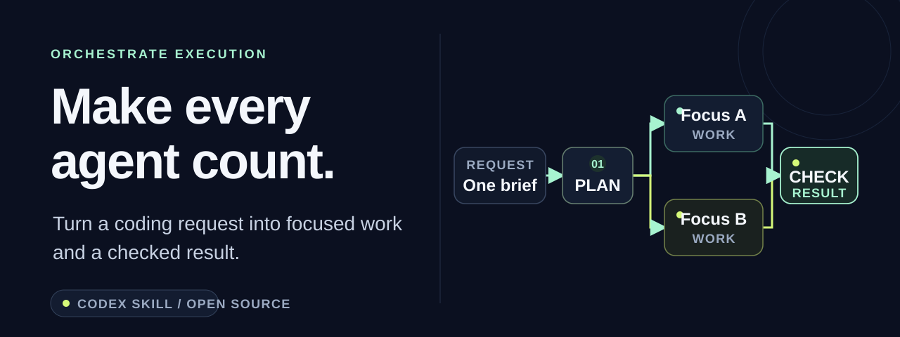
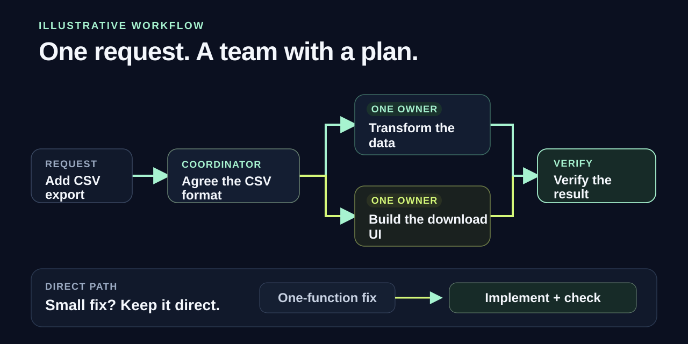
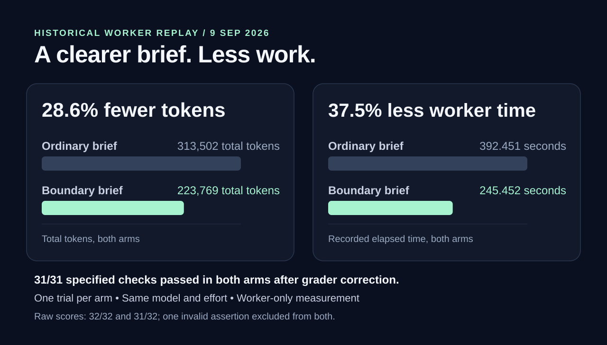
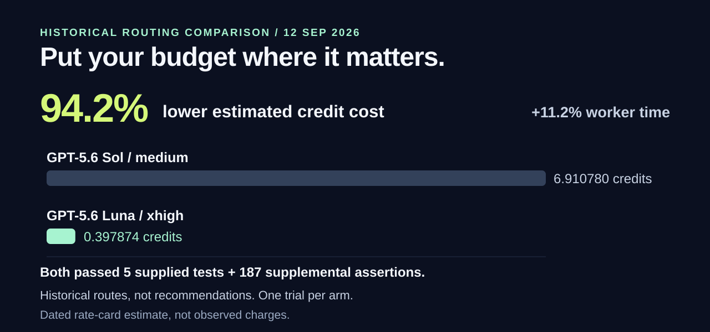

# Orchestrate Execution

**Give your coding agents a game plan.**

Orchestrate Execution gives Codex a playbook for turning a big request into focused work: choose the right level of reasoning, give each worker a clear job, and bring the results back with proof. Spend your attention on what you want to build.

**[Get started](#get-started)** · **[See the numbers](#the-numbers-behind-the-approach)** · **[Explore examples](docs/examples.md)**

[](https://github.com/K0enna/orchestrate-execution/actions/workflows/validate.yml) · [MIT licensed](LICENSE) · Built for Codex

## A better plan for the work ahead

Agent work gets harder to follow when tasks overlap, everyone reloads the same context, and “done” arrives without a check you can inspect. This skill gives the work a clear shape.

- **Keep small work small.** A one-function fix stays direct. Save the coordination for jobs that benefit from it.
- **Put the right effort on each job.** Give settled work to an eligible lower-cost model; keep difficult decisions with the agent equipped to resolve them.
- **Let independent work move together.** Give each worker its own outcome, files and checks, while the coordinator handles integration.
- **Know what actually finished.** Bring back the change, the check results and anything still open. Reuse valid proof instead of repeating sound work.

One accountable coordinator keeps the whole job moving. Each worker gets a bounded assignment and a clear finish line.

## From a request to a checked result

Ask for CSV export. Agree the data format, give the independent pieces clear owners, then verify the combined result. For a small fix, take the direct path.



The [worked examples](docs/examples.md) show the playbook in action, from a single repair to coordinating several independent changes.

## The numbers behind the approach

The workflow grew out of experiments with clearer assignments and more selective model routing. Two historical comparisons show why those choices are worth making deliberately.

### A clearer assignment used fewer tokens

In one same-model worker replay, the more explicit assignment used **28.6% fewer total tokens** and **37.5% less recorded worker time**. Both arms passed the same 31 specified checks after the documented grader correction.



### The model choice changed the cost

A separate routing comparison returned a **94.2% lower historical credit-cost estimate**. Both routes passed the supplied and supplemental checks. The lower-cost route took **11.2% longer**: a useful trade-off when the task can meet the same acceptance requirements with a less expensive model.



These are small, historical worker-level comparisons, not promised savings from this release or measured account charges. The current decision-only probe used **9.3% more tokens** with the skill and tied the baseline on the unambiguous cases. [Read the methodology, raw scores and current results](docs/benchmarks.md).

## Get started

**Copy one folder. Bring your next task.**

1. Copy [`skills/orchestrate-execution`](https://github.com/K0enna/orchestrate-execution/tree/main/skills/orchestrate-execution) into your project's `.agents/skills/orchestrate-execution` directory. Keep any existing installation until you have compared it. [Copy-and-paste installation instructions →](docs/install.md)
2. Start a Codex session in that project and confirm the skill is available.
3. Give it a concrete outcome:

```text
Use $orchestrate-execution to add CSV export to this app.
Keep the work focused, choose direct work or bounded delegation,
and verify the result before returning it.
```

The skill works with the model choices and tools available in your Codex setup. It is an instruction package you can read and adapt, with no service to host or package manager required for the skill itself. You keep control of what gets published, deployed or changed.

## Built in the open

The repository includes the full skill, worked examples, a reproducible decision probe and a coding smoke test. Package checks and **16 deterministic tests** run on Windows and Ubuntu in CI. The coding smoke test passed its two supplied and six independent test methods.

[How the skill works](skills/orchestrate-execution/SKILL.md) · [Design and research](docs/design.md) · [Release checks](docs/release-checks.md) · [Contribute](CONTRIBUTING.md)

Use it, adapt it, and bring back what you learn. [MIT licensed](LICENSE).
